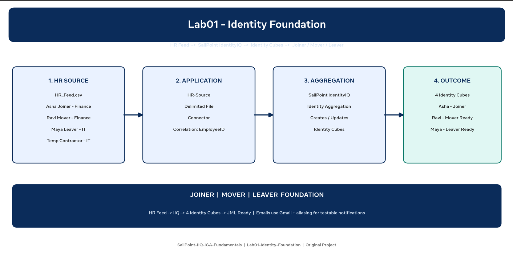

# SailPoint-IIQ IGA Fundamentals

**Author:** Sanjeev Shrestha | Dallas–Fort Worth Area, TX (Shrestha Technologies)  
**Target Roles:** IAM Engineer / Identity Engineer / SailPoint Engineer (2027)  
**Certification Focus:** Preparing for SailPoint Identity Security Engineer  
**Environment:** SailPoint IIQ, GitHub, Excel 

## 4 Labs Architecture Overview
 

## Quick Navigation and Lab Execution Status

| Lab       | Focus Area                                | Status    | Jump to Lab                                                                  |
|-----------|-------------------------------------------|-----------|------------------------------------------------------------------------------|
| **Lab 1** | Identity Foundation | Completed | [Go to Lab 1 >>](#lab-1-RBAC-Model)                       |
| **Lab 2** | SAML SSO Integration    | Completed | [Go to Lab 2 >>](#lab-2-SAML-SSO-Integration) |
| **Lab 3** | MFA Policy | Completed | [Go to Lab 3 >>](#lab-3-MFA-Policy)               |
| **Lab 4** | JML Lifecycle          | Completed | [Go to Lab 4 >>](#lab-4-JML-Lifecycle)                        |
---
## Executive Summary and Business Impact
Implemented an end-to-end IAM environment using Okta, RBAC, SAML 2.0 federation, Adaptive MFA, and automated Joiner-Mover-Leaver lifecycle with access governance across five hands-on labs.

* **RBAC Model (Lab 1):** Core Okta Developer Tenant *.okta.com, Groups Finance-Team, HR-Team, IT-Admins, Contractors, Finance-Portal-Temporary-Access, Principle Least Privilege Access, no direct app assignments.
* **SAML SSO Integration (Lab 2):** SAML 2.0 federation IdP Okta, SP Apps Finance Portal, HR Portal, IT Admin Portal, SAML ACS URL, Single Sign-On via group assignment.
* **MFA Policy (Lab 3):** High Risk Admin Access Policy Applies to IT-Admins Group, Password + Okta Verify, Step-up Auth, DENY on policy violation, Zero Trust for admin.
* **JML Lifecycle (Lab 4):** Joiner Department=Finance→Finance-Team→Finance Portal, Mover Finance→HR→HR-Team→HR Portal old revoked new granted, Leaver Deactivated→No apps, Groups kept for audit.
* **Users Managed:** 7 Okta users, 5 Groups, 3 SAML Apps, 4 Group Rules (Assign Finance Users, Assign HR Users, Assign IT Admins, Assign Contractors), 1 High Risk Admin MFA Policy
---
## Key Skills Demonstrated
* Identity Foundation
* SAML SSO Integration
* MFA Policy
* JML Lifecycle
* Access Governance  
## Technologies Used
| Category | Technologies |
|-----------|-------------|
| Identity Platform | Okta Workforce Identity Cloud |
| Authentication | MFA, Okta Verify |
| Federation | SAML 2.0, Identity Federation, Single Sign-On (SSO) |
| Authorization | RBAC, Group-Based Access Control |
| Lifecycle | JML Simulation, Okta Profile Attributes, Group Rules |
| Governance | Access Governance, Access Reviews |
| Security Models | Least Privilege, Zero Trust |
| IAM Concepts | Provisioning, Deprovisioning, Access Certification |
## Detailed Lab Implementations and Visual Proof

### Lab 1: Identity Foundation
**Key Learnings and Takeaways:**
1. **HR Is The Authoritative Source:** IIQ does not invent identity data — it reflects HR truth. Every test in this lab started with a change in `HR_Feed.csv`, not a manual edit in IIQ. If HR is wrong, IIQ is wrong.
2. **Correlation with EmployeeID Prevents Duplicates:** Using `EmployeeID` as the Identity + Correlation key ensures one person = one Identity Cube, even when department, title, or email changes. Without it, a Mover becomes two people in IIQ.
3. **Mover/Leaver Start In HR:** Ravi moved Finance → IT in HR, IIQ showed IT. Contractor left, HR said Terminated, IIQ showed Terminated.
   But IIQ still said Account = Active. Why? HR Status and Account Status are 2 different things. Turning off the account happens in Lab 04.   

📸 <b>Click here to view Lab 1 Diagrams and Screenshots >></b>

 
 
 #### Architecture Diagram

#### Administration and Configuration Captures
* **People:**  
  
* **Groups:**  
  
* **Applications:**  
  
* **Application People Example:**  
  
* **Application Group Example:**  
  

---
**[↑ Back to Lab Execution Status](#lab-execution-status)**

### Lab 2: SAML SSO Integration
**Key Learnings and Takeaways:**
* SAML is IdP trusting SP: Okta (IdP) sends a login proof to the test app (SP). Alex Chen gets access because he's in IT-Admins group - Alex Chen → IT-Admins → App. That's how all work apps work.
* 4 fields must be exact: ACS URL (where to send login), Entity ID (app's ID), Name ID = Email, Username = Email. One typo and SSO fails.
* Assign via groups: Assigned app to IT-Admins group, not directly to Alex. Easily manageable and scalable.

📸 <b>Click here to view Lab 2 Diagrams and Screenshots >></b>

 

#### Architecture Diagram

#### SSO Integration 

* **SAML App IT Admin Groups:**  
  
* **IT Admins Alex Chen:**  
  
* **SAML SSO Integration:**  
  

---
**[↑ Back to Lab Execution Status](#lab-execution-status)**

### Lab 3: MFA Policy

**Key Learnings and Takeaways:**
* Privileged apps need stronger login: IT Admin Portal is high-risk, so it needs Password + Okta Verify MFA for IT-Admins group, not just password like normal apps.
* 2 rules matter: Rule 1 = IF IT-Admins THEN Password + Another Factor, Rule 2 = Catch-all Deny for everyone else. Without catch-all, anyone can get in.
* Assign policy to app, not to user: Assigned High Risk Admin Access Policy directly to IT Admin Portal app in Sign On > User authentication, so Alex Chen gets MFA prompt when he logs in.

📸 <b>Click here to view Lab 3 Diagrams and Screenshots >></b>

 

#### Architecture Diagram

#### MFA Policy
* **IT Admins Rule Details (High Risk Admin Access Policy):**  
  
* **App Assigned to Policy:**  
  
* **IT Admins Alex Chen:**  
  

---
**[↑ Back to Lab Execution Status](#lab-execution-status)**

### Lab 4: JML Lifecycle

**Key Learnings and Takeaways:**
* Group Rules automate JML: Department = Finance → Rule If Finance Then Finance-Team auto-assigns group and app. No manual work. This lab simulates an HR-driven identity lifecycle using Okta profile attributes and group rules. A real implementation would integrate an authoritative HR system.
* Mover removes old access: Changed Department Finance→HR → Finance-Team auto-removed, HR-Team auto-added. Old app revoked, new app granted. Prevents extra access.
* Leaver removes apps, keeps groups for audit: Deactivate = No apps assigned. HR-Team stays in Groups tab for audit history. Real flow: Deactivate now, Delete after 30 days.

📸 <b>Click here to view Lab 4 Diagrams and Screenshots >></b>

 

#### Architecture Diagram

#### JML Lifecycle Proof
* **Daniel Reed Joiner Finance:**  
    

* **Daniel Reed Mover HR:**  
   

* **Daniel Reed Leaver Deactivated:**  
    

---
**[↑ Back to Lab Execution Status](#lab-execution-status)**

### Lab 5: Access Governance

**Key Learnings and Takeaways:**
* Temp group, not permanent team - Daniel HR needs Finance temporary - Created Finance-Portal-Temporary-Access group for Finance Portal, not Finance-Team - Prevents SoD HR+Finance
* Applications tab shows source - My Apps shows HR + Finance, but Applications tab shows Finance via temp group and HR via HR-Team - Auditors check this - RBAC
* Temp access must be removed - Lab 5 manual - No auto-remove - Prod needs Workflows for auto-revoke - Manual causes orphaned access

📸 <b>Click here to view Lab 5 Diagrams and Screenshots >></b>

 

#### Architecture Diagram

#### Exception Access Proof
* **Daniel Reed Exception Access - My Apps:**  
  

* **Daniel Reed Temp Access - Applications Assignment via Temp Group:**  
  

---
**[↑ Back to Lab Execution Status](#lab-execution-status)**

## Production Considerations

This lab simulates IAM concepts using an Okta Developer Tenant.
Enterprise implementations would typically include:
- Active Directory Integration
- SCIM Provisioning
- HR Source Systems
- Automated Access Reviews
- Okta Workflows
- SIEM Monitoring

## Original Repository & Credits
This hands-on lab series was adapted and built upon the foundational framework provided by [SuhaibAN/okta-workforce-iam-lab](https://github.com/SuhaibAN/okta-workforce-iam-lab). Full original references can be found in [REFERENCE.md](REFERENCE.md).

